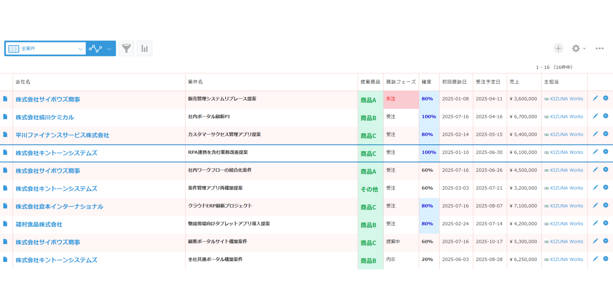

本記事は、kintoneの構築・カスタマイズ支援とプラグイン開発の実務経験を持つ筆者が、サイボウズ公式ヘルプの記載と、現場から実際に寄せられた声をもとに整理したものです。

「前のExcelのほうが早かった」。kintoneを入れて数か月たつと、たいていどこかの部署からこの一言が出てきます。ところが詳しく聞いてみると、不満は「kintone全体」ではありません。入力画面が縦に長い、ルックアップの［取得］を押し忘れる、40件の状態をまとめて変えられない――といった、**特定の画面の特定の操作**に集中しています。

だから直し方も、場面ごとに分けて考えたほうが早く片づきます。この記事でわかるのは次の3点です。

- 「使いにくい」と言われやすい8つの場面と、それぞれの原因
- 場面ごとに、kintoneの標準機能でどこまで直せるか（と、その限界）
- 標準で届かない部分を埋めるプラグインと、定着させるための運用のコツ

## 「使いにくい」は8つの場面に集中する

最初に全体像を表にしておきます。原因の多くは、kintoneの仕様そのものより、**仕様を知らないまま作った設計**の側にあります。

| # | 現場の声 | 主な原因 | 標準で直せるか |
|---|---|---|---|
| 1 | 入力画面が長くて、どこを書けばいいか分からない | 全項目が常に並ぶ | 一部（グループ・項目の整理） |
| 2 | ルックアップが面倒、取り違える | ［取得］操作が毎回必要 | ほぼ不可 |
| 3 | 一覧でまとめて直せない | 一括で同じ値を入れる機能がない | CSV再読み込みなら可 |
| 4 | 探しているレコードが見つからない | キーワード検索の対象が文字列系だけ | 一部（工夫で回避） |
| 5 | 一覧が多すぎて選べない | 一覧にアクセス権を設定できない | 不可 |
| 6 | テーブル（明細）が扱いにくい | 並べ替え・一覧表示などの制約 | 不可 |
| 7 | 合計を見るのにグラフへ移動する | 一覧に合計を出せない | 不可（グラフで代用） |
| 8 | 通知が埋もれて気づかない | 通知が他のお知らせと混ざる | 一部（条件を絞る） |

「標準で直せるか」が「一部」の場面は、設定を見直すだけで不満がかなり減ります。「不可」の場面は、運用で我慢し続けるより、早めにプラグインかカスタマイズで手当てしたほうが結果的に安くつきます。順に見ていきましょう。

## 1. 入力画面が長くて、どこを書けばいいか分からない

いちばん多い不満です。kintoneのフォームは、置いた項目がいつも全部表示されます。区分によって使わない欄も、確度が低い段階では書けない欄も、同じように並びます。

項目が10個程度なら気になりません。30、40と増えてくると、入力する側は「全部埋めないといけないのか」と迷い、入力漏れと誤入力が増えます。

### 標準でできること

まず効くのは、項目そのものを減らすことです。「念のため」で置いた欄が、実は誰にも読まれていないケースはよくあります。そのうえで、次の2つを組み合わせます。

- **グループフィールドでまとめる**：関連する項目をグループに入れ、普段は閉じておく。開閉は利用者がクリックで切り替えられます
- **ラベルで入力の決まりを書く**：「法人の場合のみ入力」のように、欄の上に一言添える

### 標準の限界と、プラグインでの直し方

標準では、**入力した値によって欄を出し分ける**ことができません。フィールドのアクセス権は「人」で見せ方を変える機能で、値では切り替わらないためです。詳しくは[kintoneの条件分岐で項目を表示・非表示にする方法](/blog/kintone-jouken-bunki/)で解説しています。

「区分が法人のときだけ会社名を出す」「確度100%なら受注予定日を必須にする」といった出し分けは、[条件分岐フォーム for kintone](/plugins/conditional-form/)（無料）で、条件と動作を選ぶだけで設定できます。

項目は減らせないが見通しをよくしたい、という場合は[アコーディオンタブ for kintone](/plugins/accordion-tab/)（無料）が向いています。縦長のフォームを見出しごとに折りたたみ、必要な節だけ開いて入力できます。

必須項目や要注意の値が埋もれている場合は、色で目立たせるのも手です。[フィールドスタイラー for kintone](/plugins/field-styler/)（無料）なら、背景色・文字色・条件付きのスタイルを、画面を作り直さずに設定できます。

## 2. ルックアップが面倒、同名の顧客を取り違える

ルックアップ（他のアプリの値を参照してコピーする機能）は便利な反面、操作の手数で嫌われやすい機能です。

つまずくのは、**値を入れただけでは取得されない**点です。［取得］ボタンを押すか、参照画面で選ぶ操作が毎回要ります。押し忘れたまま保存しようとしてエラーになる、という流れを1日に何度も繰り返すと、「使いにくい」の声になります。

もう1つは取り違えです。参照画面に会社名しか出ていないと、同名や似た名前の顧客を選び間違えます。

### 標準でできること

取り違えには、標準の設定で手を打てます。

- コピー元のキー項目に<strong>「値の重複を禁止する」を設定</strong>する
- ［選択時に表示するフィールド］に、電話番号や住所など**見分けがつく項目を足す**

ただし［取得］の手数そのものは、標準では減らせません。ルックアップの仕様と、つまずきやすいポイントは[kintoneルックアップの使い方](/blog/kintone-lookup-kaisetsu/)にまとめています。

### プラグインでの直し方

[ルックアップサジェスト for kintone](/plugins/lookup-suggest/)（無料）は、入力中に候補を欄の直下に表示します。候補をクリックすれば取得まで終わるので、ダイアログを開いて探す手順がなくなります。電話番号や住所も候補に並べられるため、同名顧客の取り違えも防げます。

## 3. 一覧でまとめて直せない

「今月分の40件を『請求済』にしたい」。Excelなら列をドラッグして一瞬で終わる作業が、kintoneではそうはいきません。kintoneには、**一覧で選んだ複数のレコードに同じ値をまとめて入れる標準機能がありません**。

### 標準でできること

標準の手段は2つです。

1. **一覧のインライン編集**で1件ずつ直す。アプリ管理者が［レコード一覧でのインライン編集］を有効にしておく必要があります
2. **CSVを書き出して直し、再読み込み**して上書きする

5〜10件ならインライン編集で十分です。ただしインライン編集は1行ずつの操作で、テーブル内の項目やルックアップの設定に使っている項目は編集できません。CSVは件数が多いときに有効ですが、更新キーの指定を誤ると別のレコードを上書きするおそれがあります。手順と注意点は[kintoneでレコードを一括更新する方法](/blog/kintone-ikkatsu-koushin/)で詳しく扱っています。

### プラグインでの直し方

絞り込んだレコードに同じ値を入れたいなら、[かんたん一括更新 for kintone](/plugins/bulk-update/)（無料）が手軽です。

レコードごとに違う値を入れたい、Excelの感覚で直したい、という場合は[シート編集 for kintone](/plugins/sheet-edit/)（無料）が向いています。一覧（[カスタマイズビュー](/blog/kintone-custom-view/)）を表計算ソフトのようなグリッドに置き換え、範囲選択・コピー＆ペースト・連番のオートフィルで直接編集できます。

## 4. 探しているレコードが見つからない

情報が見つからない体験が続くと、システムそのものへの信頼が落ちます。kintoneの検索で引っかかりやすいのは、次の2点です。

- **キーワード検索の対象は文字列系のフィールドだけ**。数値・日付・ドロップダウン・ラジオボタン・チェックボックスは検索されません（[公式ヘルプ：データを検索する](https://jp.kintone.help/k/ja/search/search_details.html)）
- 項目を指定した絞り込みは、漏斗アイコンを開いて条件を組み、適用する、という手順を毎回踏む

「ステータスで探したい」「金額で探したい」と思った人が検索窓に入力しても、何も出てきません。kintoneに慣れていない人ほど、ここで諦めます。

### 標準でできること

よく使う条件は、絞り込みを組んだうえで**一覧として保存**しておけば、毎回組み直さずに済みます。検索対象外の項目も、文字列（1行）の自動計算に値をコピーしておけばキーワード検索で拾えるようになります（[公式FAQ](https://kintone-faq.cybozu.co.jp/hc/ja/articles/47397380180633)）。フィールドは増えますが、標準機能だけでできる回避策です。

### プラグインでの直し方

一覧画面に検索窓を常設したい場合は、[クイックサーチ for kintone](/plugins/quick-search/)（無料）が使えます。ツールバーの横に検索バーを置き、複数のキーワードをAND/ORで切り替えて絞り込めます。

項目ごとに件数つきの候補から選んで絞り込みたい、日付を期間のボタンで絞りたいなら、[クイックフィルター for kintone](/plugins/quick-filter/)（有料）が候補になります。ほかの選択肢も含めた比較は[kintoneの検索・絞り込みを改善するプラグイン比較](/blog/kintone-kensaku-plugin-hikaku/)をご覧ください。

## 5. 一覧が多すぎて、どれを選べばいいか分からない

部署別・担当別に一覧を作り込むほど、一覧の切り替えメニューは長くなります。原因は、**一覧にアクセス権を設定できない**ことです（[公式ヘルプ](https://jp.kintone.help/k/ja/trouble_shooting/app_qa/list_access_rights.html)）。中身のレコードやフィールドは権限で守れても、一覧の名前は全員のメニューに並びます。

アプリを開いたときに最初に出る一覧も、アプリにつき1つだけです。人によって最初に見たい一覧が違っても、標準では出し分けられません。

### 標準でできること

一覧の名前に【営業一課】【個人】のような接頭辞を付けて並べる、使われていない一覧を定期的に棚卸しする、といった運用で、ある程度は抑えられます。ただ「消してよいか分からない一覧」は結局残りがちです。整理の順番は[kintoneのレコード一覧の使い方](/blog/kintone-record-list/)で解説しています。

### プラグインでの直し方

[一覧コントロール for kintone](/plugins/view-control/)（無料）を使うと、一覧の表示・非表示をユーザー・組織・グループ単位で出し分け、対象者ごとに最初に開く一覧も指定できます。営業一課の人のメニューには、営業一課に関係する一覧だけが並ぶ状態にできます。

## 6. テーブル（明細）が扱いにくい

サジェストに「kintone テーブル 使いにくい」が出てくるほど、テーブル（サブテーブル）への不満は根強いものがあります。標準でぶつかる代表的な制約は次のとおりです。

| できないこと | 現場で困る場面 |
|---|---|
| 一覧に明細の中身を常に表示できない | 今週の出荷明細を一覧でざっと見たい |
| 行の並べ替えができない | 見積の途中に1行差し込みたい |
| テーブル内の項目でソートできない | 明細の納品日順にレコードを並べたい |
| テーブル外の計算式で使えるのはSUMとCONTAINSだけ | 条件に合う行だけを合計したい |
| 列ごとのアクセス権を設定できない | 原価の列だけを隠したい |

どれも公式ヘルプに明記された仕様で、設定では回避できません。テーブルにするか別アプリに分けるかの判断基準と、制約ごとの回避策は[kintoneテーブル（サブテーブル）の使い方](/blog/kintone-table-tsukaikata/)で詳しく整理しています。

明細を一覧で見て、その場で直したい場合は、先ほどのシート編集が明細の行展開と行ごとの編集にも対応しています。

## 7. 合計を見るのに、いちいちグラフ画面へ移動する

kintoneの一覧には、件数は出ますが**金額などの合計は出ません**。「今月の受注合計はいくら？」と聞かれるたびに、グラフ画面を開くかCSVを書き出してExcelで足すことになります。

### 標準でできること

よく見る集計は、グラフ（集計表）として保存しておけば、アプリのグラフメニューからすぐ開けます。集計方法はレコード数・合計・平均・最大値・最小値の5種類です。一覧・テーブル・関連レコードのそれぞれで合計を出す方法は[kintoneの集計方法まとめ](/blog/kintone-shukei/)で比べています。

### プラグインでの直し方

一覧を見ながら合計を知りたいなら、[集計サマリーバー for kintone](/plugins/summary-bar/)（無料）が向いています。一覧の上部に件数・合計・平均などのカードを並べ、絞り込みに合わせて数値が変わります。

## 8. 通知が埋もれて、承認依頼に気づかない

通知は便利ですが、増えすぎると誰も読まなくなります。自分宛のメンションや承認依頼が、ほかのお知らせに混ざって数日放置される。これも「kintoneは見落とす」という不満の形で出てきます。

### 標準でできること

まず効くのは、**通知の条件を絞る**ことです。アプリの条件通知で「レコードの編集」を全員に送っていると、それだけで通知一覧が埋まります。値をきっかけにするなら「レコードの条件通知」、期日をきっかけにするなら「リマインダーの条件通知」に寄せると、意味のある通知だけが残ります。3種類の使い分けと「通知が来ない」ときの確認順は、[kintoneの通知設定ガイド](/blog/kintone-tsuuchi-settei/)にまとめました。

### プラグインでの直し方

kintoneを開かない人に届けたい場合は、普段使っているチャットへ流すのが確実です。[チャット通知 for kintone](/plugins/chat-notify/)（有料）は、Slack・Microsoft Teams・Google Chatなどへ、レコードの値を差し込んだ本文で通知を送れます。

## 仕組みより先に見直したい、運用の3つの癖

ここまでは画面と機能の話でした。ただ、同じアプリでも部署によって評価が真っ二つに分かれることがあります。その差はたいてい、作り方と育て方にあります。

### 最初から全部を載せようとする

例外処理まで含めた「完璧なアプリ」を最初に作ろうとすると、項目が増え、公開が遅れ、場面1の「長い入力画面」がそのまま出来上がります。まず「この業務が最低限回る」形で一部の部署から使い始め、出てきた不満をもとに足していくほうが、結果的に早く定着します。

### 作った人だけが使い方を知っている

kintoneは誰でもアプリを作れる分、似た名前のアプリが部署ごとに増えがちです。アプリ名に「誰が・何のために使うか」が分かる言葉を入れる、作成前に相談する窓口を決める、といった最低限のルールがあるだけで、迷子は減ります。アイコンで見分けたい場合は、[kintoneのアプリアイコンを無料で作成できるShirushi](/tools/Shirushi.html)で、ブラウザだけで透過PNGを作れます。

### 不満を言う場所がない

「使いにくい」は、言ってもらえれば直せます。困るのは、黙ってExcelに戻られることです。改善要望を投稿するアプリを1つ用意し、受け付けた要望と対応状況を見えるようにしておくと、現場は「言えば直る」と分かり、不満が表に出てくるようになります。管理者が一人で抱え込んでいる場合は、サイボウズ公式のユーザーコミュニティ「キンコミ」で同じ悩みの事例を探すのも有効です。

## kintoneそのものに向かない業務もある

公平のために書いておくと、設計や運用を工夫しても、kintoneに載せないほうがよい業務もあります。

- **大量データを複雑に分析する業務**：多数のアプリをまたいだ分析は、BIツールなど専用の道具のほうが向いています。kintoneでどこまでできるかは[kintoneでBIのようにデータを可視化する方法](/blog/kintone-bi-tool-dashboard/)で整理しています
- **厳密な会計処理**：仕訳や帳簿は会計ソフトの領域です。kintoneで無理に組むと、プラグインを重ねるほど費用も保守も重くなります
- **入力項目が極端に多い帳票**：1アプリに置けるフィールドは最大500個ですが、公式ヘルプも項目が多いほど表示が遅くなる場合があると述べています

kintoneが得意なのは、日々の記録・案件や問い合わせの管理・申請と承認のように、**チームで情報を溜めて共有する業務**です。そこに範囲を絞ると、「使いにくい」の声はかなり減ります。

## どこから手をつけるか

すべてを一度に直す必要はありません。現場の声が多い場面から、次の順で手を打つのが効率的です。

| 現場の声 | 最初の一手（標準） | それでも足りなければ |
|---|---|---|
| 入力画面が長い | 項目を減らす・グループでまとめる | 条件分岐フォーム／アコーディオンタブ |
| ルックアップが面倒 | 重複禁止・表示項目の追加 | ルックアップサジェスト |
| まとめて直せない | インライン編集・CSV再読み込み | かんたん一括更新／シート編集 |
| 見つからない | 絞り込みを一覧として保存 | クイックサーチ／クイックフィルター |
| 一覧が多すぎる | 命名ルールと棚卸し | 一覧コントロール |
| 合計が見えない | グラフ（集計表）を保存 | 集計サマリーバー |
| 通知に気づかない | 通知の条件を絞る | チャット通知 |

目的別にプラグインを探したい場合は、[kintoneプラグインのおすすめと選び方（やりたいこと別）](/blog/kintone-muryou-plugin-osusume/)が近道です。

## よくある質問

**Q. プラグインをたくさん入れると、かえって使いにくくなりませんか？**

なり得ます。同じ画面に手を入れるプラグインを重ねると、ボタンが増えて画面が散らかります。まず標準の設定で直せる部分を直し、残った不満1つにつき1つ、という入れ方をおすすめします。入れる前に、検証用のアプリで現場の人に一度触ってもらうと失敗が減ります。

**Q. JavaScriptで自作するのとプラグイン、どちらがよいですか？**

社内に保守できる人がいるなら、JavaScriptでの自作も選択肢です。ただ、書いた人が異動すると直せなくなる、kintoneのアップデートで動かなくなったときに気づけない、といったリスクがあります。設定画面から条件を変えられるプラグインのほうが、担当者が替わっても運用を続けやすくなります。

**Q. 「使いにくい」と言われたら、まず何を聞けばよいですか？**

「どの画面で、何をしようとしたときか」を聞いてください。「全部使いにくい」という答えでも、実際に操作してもらうと、たいてい特定の1〜2画面に行き着きます。この記事の8つの場面のどれに当たるかが分かれば、手の打ち方も決まります。

**Q. スマートフォンでは使いにくいと言われます**

スマートフォンでは画面が狭い分、場面1の「長い入力画面」がより強く効いてきます。スマートフォンで入力する項目を絞り、条件分岐で不要な欄を隠すだけでも、操作量はかなり減ります。

## まとめ

- kintoneの「使いにくい」は、全体ではなく**特定の8つの場面**に集中している
- 入力画面の長さ・通知の埋もれ・検索の不便さは、**標準の設定を見直すだけでも**かなり改善できる
- 値による項目の出し分け、ルックアップの手数、一覧での一括編集、一覧の権限、一覧の合計は、**標準では直せない**。プラグインかカスタマイズで手当てする
- 最初から全部を載せず、小さく始めて、現場の不満を言える場所を作る
- 大量データの分析や厳密な会計など、kintoneに向かない業務は無理に載せない

## kintone活用でお困りではありませんか？

「現場から使いにくいと言われているが、どこから直せばよいか分からない」といったご相談を承っています。プラグインの導入相談だけでも構いません。[お問い合わせ](/contact/)からお気軽にご連絡ください。

### 関連記事・サービス

- [条件分岐フォーム for kintone](/plugins/conditional-form/) — 入力値に応じて項目の表示・非表示や必須を切り替え（無料）
- [ルックアップサジェスト for kintone](/plugins/lookup-suggest/) — 入力中に候補を表示し、クリックで取得まで完了（無料）
- [シート編集 for kintone](/plugins/sheet-edit/) — 一覧を表計算のようなグリッドにして直接編集（無料）
- [kintoneの条件分岐で項目を表示・非表示にする方法](/blog/kintone-jouken-bunki/) — 標準でしのぐ工夫とJavaScriptのサンプル
- [kintoneテーブル（サブテーブル）の使い方](/blog/kintone-table-tsukaikata/) — できないことと、選んだ行だけ集計する方法
- [kintoneプラグイン一覧](/plugins/) — 無料で使えるプラグインをまとめて掲載
